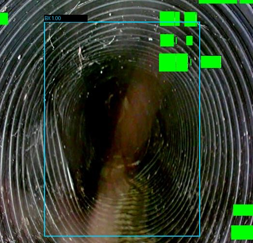
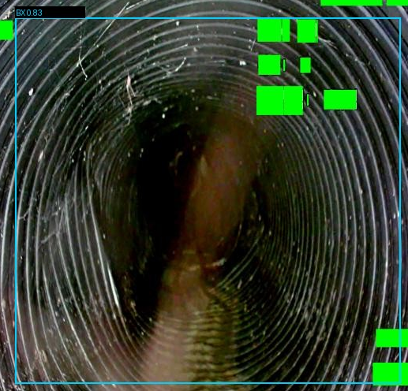
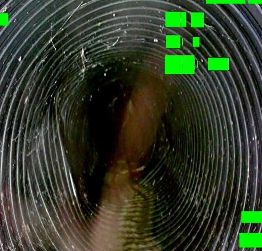
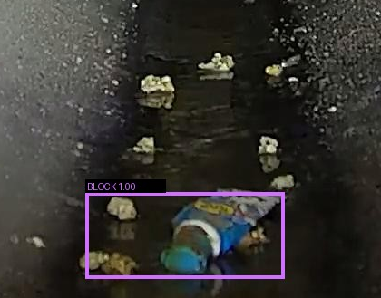
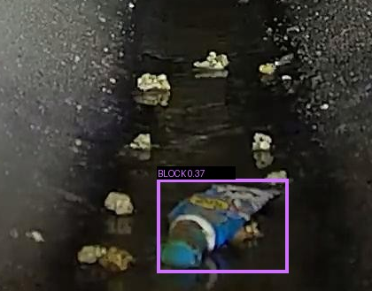
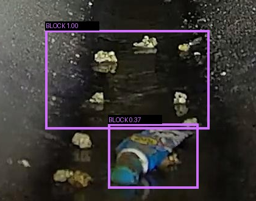

# YOLO26m 与视觉复检的两组实验图像摘录

下表保留 2026-09-18 冻结测试集（606 张图）中的两组实验叠框图。三列依次展示数据集标注、YOLO26m 输出和当时的 Qwen 引导复检融合结果，三个视图均取自同一次实验的历史图库。每个案例在三个视图中裁取完全相同的原像素区域，并无损保存为 PNG。按同类、IoU ≥ 0.5、一对一匹配计分。点击图片可查看大图。[实验工具](../../.trellis/tasks/09-18-vlm-yolo26m-comparison/run_comparison.py) · [复检差异分析](../../.trellis/tasks/09-18-vlm-yolo26m-comparison/fusion_diagnosis.md)

## Deformation

**变形候选被撤销。** 样本 `sewer2403__DF_53_png.rf.5e30f50de9eb202e294d8ffbd9e092e9`，原帧为 640 × 640 像素。对照图截取原图的 `x=[67,584), y=[52,548)`，保留完整标注框和检测框，省略周围像素。绿色遮挡来自原图库。

| 数据集标注 | YOLO26m 初查 | 当时的复检融合 |
|---|---|---|
|  |  |  |
| 一个 BX（变形）框。 | BX 分数 0.831，与标注 IoU 为 0.617。 | 视觉模型将环形肋条和远端轮廓解释为正常波纹与透视，旧策略删除原框。 |

初查命中 1 个标注，融合后漏检 1 个。用后来的保守策略重放同一份复检意见，原框保留并转交人工判断。

## Obstruction

**新增堵塞框与标注错开。** 样本 `sewer2403__911ca174a34a5d7f1cd40e317c7519de`，原帧为 1920 × 1080 像素。对照图截取原图的 `x=[780,1200), y=[615,944)`，保留两个预测框与唯一标注框，省略周围的巡检信息叠字。

| 数据集标注 | YOLO26m 初查 | 当时的复检融合 |
|---|---|---|
|  |  |  |
| 一个 BLOCK（堵塞类）框。 | BLOCK 分数 0.374，与标注 IoU 为 0.551。 | 原框保留，另在上方加入一个“底部散落杂物”框，与唯一标注的 IoU 为 0。 |

按整图类别评分，两次都报对 BLOCK。按框评分，初查为 1 个命中，旧融合为 1 个命中、1 个未匹配预测。新增框的 1.00 是旧融合的排序占位值。仅凭这份标注无法判断现场是否确有额外杂物。保守重放保留原框，将新增框列为待审建议。[保守重放记录](../../.trellis/tasks/09-18-vlm-calibration/report.md)

原始图库保存在本地实验归档的 `var/evaluations/2026-09-18-vlm-yolo26m-comparison/yolo26m_guided/gallery/<样本 ID>/`。原图左上角为坐标原点，文中区间含起点、不含终点。摘录分别来自 `ground_truth.jpg`、`yolo_raw.jpg` 和 `predictions.jpg`，直接裁取其解码像素。框和标签是图库原有叠加，引用的检测分数、匹配和复检意见均按完整原帧及同目录的 `result.json` 核对。保守重放使用 `var/evaluations/2026-09-18-vlm-conservative-fusion/conservative.json` 中相同样本 ID 的记录。
