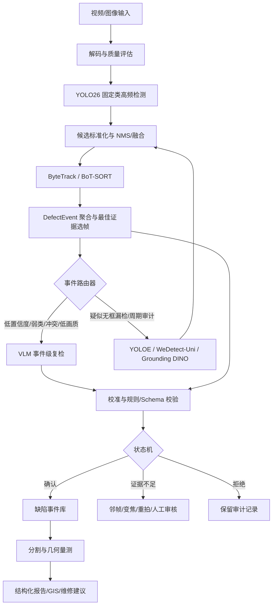

# VLM + YOLO 管网缺陷检测：架构、方法与调研总结

整理日期：2026-08-25  
适用范围：Sewer2403 五类 YOLO26s 基线与五类视频检测系统。基础类别固定为 `PL / BX / FS / BLOCK / AJ`；17 类结果只保留为历史对照，不进入当前系统的类别设计。

## 1. 直接结论

当前项目最稳妥的路线不是用一个通用 VLM 替代 YOLO26，而是建立“固定类快速检测 + 事件级语义复检 + 开放词表补召回”的双速度系统：

1. YOLO26 持续输出固定类别的框、类别和置信度；
2. ByteTrack 或 BoT-SORT 把逐帧框聚合成稳定 `track_id` 和 `DefectEvent`；
3. 事件路由器只把低置信度、弱类、跨帧冲突、低画质或模型分歧事件送给 VLM；
4. VLM 根据 ROI、上下文、多帧、专家定义、正例原型和难负例进行接受、改类、拒绝或请求更多证据；
5. YOLO26 完全没有出框时，必须由 YOLOE、WeDetect-Uni、YOLO-World 或 Grounding DINO 等第二候选源补充候选；
6. 新候选重新进入融合、跟踪和 VLM 复检，不能绕过时序确认；
7. 外部状态机拥有最终业务决定权，VLM 不能直接报警、生成几何真值或控制机器人。

需要特别区分：

- **在线 VLM 复检**可以改善最终事件级 precision、macro-F1、校准和人工审核效率，但不会自动改变 YOLO26 权重或单模型 mAP；
- **开放词表第二候选源**可以提高候选召回，解决部分“YOLO 完全没有出框”的漏检；
- **VLM/LLM 离线监督、伪标签或蒸馏**才可能得到一个部署时不依赖 VLM、但权重本身更强的新 YOLO；
- **LLM Agent 与报告生成**负责工具编排和事实表达，不等于检测精度提升。

## 2. 当前项目基线与问题定位

### 2.1 Sewer2403 五类完整模型

当前服务器交付包中的主模型是：

```text
YOLO26s + imgsz=960 + 100 epochs
PL / BX / FS / BLOCK / AJ
```

验证集共 1,904 张图片、1,407 个五类目标和 695 张负样本。总体结果为 Precision 0.636、Recall 0.592、mAP50 0.582、mAP50-95 0.389。

| 类别 | 含义 | Precision | Recall | mAP50 | mAP50-95 | 对 VLM/补召回的意义 |
|---|---|---:|---:|---:|---:|---|
| AJ | 支管暗接 | 0.895 | 0.852 | 0.917 | 0.721 | 高置信原型类；重点控制少量误报 |
| BLOCK | CJ/JG/ZW 合并的堵塞类 | 0.750 | 0.742 | 0.804 | 0.588 | 相对可靠，可作为正例原型；仍需区分真实堵塞与普通污渍 |
| PL | 破裂 | 0.644 | 0.585 | 0.585 | 0.333 | 形态跨度大；适合多帧、专家属性描述和难负例复检 |
| FS | 腐蚀 | 0.527 | 0.432 | 0.359 | 0.177 | 易与湿壁、污渍和照明混淆；优先 VLM 复检与纹理/材质建模 |
| BX | 变形 | 0.364 | 0.349 | 0.246 | 0.128 | 最弱且只有 43 个验证实例；优先补数据和几何信息，不能只靠语言判断 |

因此第一轮 VLM 实验应优先处理 `BX / FS / PL`，而不是平均地复检所有类别。`AJ / BLOCK` 可用于构造当前视频中的高置信正例原型。

### 2.2 Sewer2403 17 类历史参考（不作为当前模型路线）

17 类本地只保留日志和 `args.yaml`，没有 `best.pt`。日志中的高分类型包括：

| 类别 | 含义 | mAP50 | mAP50-95 | 判断 |
|---|---|---:|---:|---|
| Joint | 管道接口 | 0.994 | 0.865 | 外观规则，但不是病害类别 |
| TJ | 脱节 | 0.895 | 0.776 | 实际缺陷中较可靠 |
| CQ | 残墙、坝根 | 0.881 | 0.759 | 只有 16 个验证实例，统计不稳定 |
| AJ | 支管暗接 | 0.922 | 0.755 | 实际缺陷中较可靠 |
| CJ | 沉积 | 0.889 | 0.712 | 实际缺陷中较可靠 |

弱类主要是 `BX / FS / JG / QF`。这与五类模型中 BX、FS 仍然较弱相互印证：瓶颈更可能是样本量、视觉可分性、画质和几何表达，而不是类别数本身。

以上均为本地历史验证结果，不是独立测试集结论。详细证据见 `../yolov26/docs/sewer2403_5class_experiment_report.md`。

## 3. 推荐总体架构



### 3.1 快速环

快速环包括视频解码、YOLO26、候选标准化和跟踪。其目标是稳定吞吐和高候选召回，不能等待 VLM。

YOLO26 负责：

- 固定类别框、类别、分数；
- 每帧高频运行；
- 为跟踪器、事件聚合和第二阶段提供候选。

YOLO26 不负责：

- 跨帧身份稳定；
- 开放类别发现；
- 基于多帧证据的最终语义判断；
- 毫米级尺寸和维修决策。

### 3.2 跟踪与事件层

ByteTrack 可先作为简单基线；对于机器人移动镜头、管壁纹理重复和固定缺陷，普通 IoU 关联可能错配，应进一步评估 BoT-SORT、全局运动补偿、光流、视觉里程计或 SLAM。

跟踪层输出：

- `track_id`；
- 轨迹起止时间；
- 多帧类别与分数；
- 最清晰、最近、面积最大或最稳定的证据帧；
- 跨帧投票、短时漏检补偿和去重结果。

VLM 的默认调用单位是 `DefectEvent`，不是单帧。一个 2～5 秒事件通常只调用一次主复检，只有在 VLM 请求更多上下文、第二候选源产生新证据或主动重拍后才再次复检。

### 3.3 事件路由器

推荐触发条件：

- YOLO 分数位于待复检区间；
- 类别属于 BX、FS、PL 等弱类；
- 同一轨迹的类别投票或框位置不稳定；
- 原图与增强图结果冲突；
- 图像模糊、过曝、污渍、水雾、遮挡或分辨率不足；
- YOLO26 与第二候选源分歧；
- 周期性无框漏检审计；
- VLM 返回 `need_more_context`；
- 高风险事件需要双模型确认。

路由器必须实现任务去重、优先级、超时、重试和背压。同一 `track_id` 的重复 VLM 请求应合并，只保留最新或质量最好的证据。

### 3.4 VLM 复检器

一次复检不应只提供紧裁剪 ROI。推荐输入包：

- 原始全帧；
- 带检测框全帧；
- 紧 ROI 和 1.5～2 倍上下文 ROI；
- 同一事件的前、中、后或最佳质量 1～3 帧；
- YOLO 类别、分数、框和轨迹稳定性；
- 管材、管径、里程、钟点位、拍摄方向和画质；
- 候选缺陷的专家定义、可观察属性、正例原型和难负例。

VLM 应输出受约束的 JSON，而不是自由文本覆盖检测结果：

```json
{
  "event_id": "pipe-001-event-00037",
  "track_id": 37,
  "decision": "accept|revise|reject|abstain|need_more_context",
  "canonical_label": "PL|BX|FS|BLOCK|AJ",
  "evidence": ["visible cue 1", "visible cue 2"],
  "confuser": "joint_shadow|null",
  "image_quality": "good|usable|poor",
  "needs_human_review": false
}
```

VLM 的自报置信度不能直接视为校准概率。需要在固定验证集上做温度缩放、逻辑回归、isotonic calibration 或分箱可靠性检查，并保留 `abstain`。

### 3.5 第二候选源

普通 ROI 复检只能判断已有框，无法恢复 YOLO26 完全没有产生候选的缺陷。第二候选源应扫描：

- 低质量或异常帧；
- 高分辨率整帧和切片；
- 轨迹中断区域；
- 周期覆盖窗口；
- VLM 请求更多上下文的区域；
- 低阈值 YOLO26 与质量异常检测器发现的可疑窗口。

当前候选优先级：

1. YOLOE：与 YOLO 系工程衔接最自然，支持文本、视觉和无提示模式；
2. WeDetect-Uni：通用候选与历史区域检索，适合研究型补召回；
3. YOLO-World：成熟开放词表基线；
4. Grounding DINO：较重，但适合离线高召回检索和标注；
5. Grounded SAM2：对候选做图像/视频掩膜与自动标注，不作为每帧主检测器。

第二候选不能直接变成正式事件。它必须关联现有轨迹或建立 tentative track，并由连续帧、VLM、几何或人工证据确认。

### 3.6 分割、量测和报告

检测框只能表示大致位置。腐蚀面积、裂缝长度、堵塞率和管道变形需要分割与真实尺度来源：双目、RGB-D、线激光、LiDAR、相机标定或已知管径约束。VLM 不能从单目 RGB 猜毫米尺寸。

报告层只能引用结构化事实：类别、时间、里程、钟点位、证据帧、校准分数、掩膜、量测和标准条款。LLM 可以组织文字，但不能补写不存在的检测或尺寸。

## 4. VLM + YOLO 方法分类

| 路线 | 是否改变 YOLO 权重 | 主要输入 | 主要输出 | 适合当前项目的作用 |
|---|---|---|---|---|
| 在线 ROI/事件复检 | 否 | YOLO 候选、多帧、上下文、专家定义 | accept/revise/reject/abstain | 降低误报、解决易混类、形成解释证据 |
| 视觉原型二次推理 | 通常否 | 第一遍高置信实例 token/embedding | 第二遍框和类别 | 用 AJ/BLOCK 等可靠实例辅助同视频复检 |
| 开放词表补候选 | 否 | 全帧/切片、文本或视觉提示 | 新候选框/掩膜 | 补完全漏检、未知异常、少样本类别 |
| VLM 伪标签教师 | 是，经过再训练 | 无标注视频、候选框、文本定义 | 经审核伪标签 | 扩充 BX/FS/PL 数据并训练新 YOLO |
| LLM/VLM 训练监督 | 是 | 区域短语、图像描述、grounding 数据 | 新检测器权重 | 把语言属性真正注入检测器训练 |
| VLM 合成异常 | 是，经过再训练 | 正常图、缺陷描述、生成/过滤模型 | 合成图和掩膜 | 少样本补充，但必须人工抽检和真实测试 |
| 测试时域适应 | 可能改变适配参数 | 新设备/新城市/新画质域 | 域适应后的预测 | 处理镜头、管材、污渍和光照域偏移 |
| Agent/报告生成 | 否 | 结构化检测、量测和规则 | 报告、查询、任务编排 | 提高工作流效率，不代表 mAP 增益 |

## 5. 代表论文与方法结论

下表将论文事实和本项目推论分开。论文在通用数据集上的 AP/F1 不能直接当作 Sewer2403 收益。

| 工作 | 正式状态 | 论文方法事实 | 对本项目的价值与边界 | 公开材料 |
|---|---|---|---|---|
| [PipeInspector / PipeInspect Agent](https://doi.org/10.1016/j.autcon.2026.106942) | *Automation in Construction*, 2026 | 图像增强、Grounding DINO、Grounded SAM、Depth Pro 与 LLM 工具编排串联 | 可借鉴增强、检测、分割、深度和报告工具链；Agent 本身不是检测增益证据 | 论文可查；未确认完整端到端训练仓库 |
| [Edge-Optimized VLM for Underground Infrastructure](https://arxiv.org/abs/2602.03742) | 2026 预印本 | 轻量 RAPID-SCAN 分割后，量化 Phi-3.5 Vision 生成缺陷摘要 | 证明“持续小模型 + 事件触发 VLM 摘要”的部署形态；不证明 VLM 回流提高分割精度 | 论文；代码状态需核查 |
| [Multi-class sewer defect detection with VLMs](https://doi.org/10.1017/wat.2026.10019) | *Cambridge Prisms: Water*, 2026 | 18 个 VLM 在 100 张 SewerML 图像上做六选一零样本分类；最佳 macro-F1 0.50，自报 confidence 不可靠 | 说明通用 VLM 尚不能替代专用检测器；必须允许拒识、校准并做领域适配 | [论文](https://www.cambridge.org/core/journals/cambridge-prisms-water/article/multiclass-sewer-defect-detection-with-visionlanguage-models/5A50F4D3610089FF1771B78D1FE69AB3)、[公开结果](https://huggingface.co/spaces/rtaormina/vlms_for_sewerml) |
| [PipeCLIP](https://doi.org/10.1109/TASE.2026.3670430) | IEEE T-ASE, 2026 | 使用缺陷条件文本与跨焦点视频表征改善管道缺陷视觉—语言对齐 | 专家属性描述、视频多焦点和缺陷语义先验值得用于 prompt/embedding；不能直接替代 bbox 检测 | DOI；匿名代码快照需核查长期可用性 |
| [YOLOE](https://openaccess.thecvf.com/content/ICCV2025/html/Wang_YOLOE_Real-Time_Seeing_Anything_ICCV_2025_paper.html) | ICCV 2025 | 将文本提示、视觉提示和无提示词表统一到实时检测/分割 | 当前最优先的第二候选源与视觉原型工具；需在 Sewer2403 实测候选互补性 | [官方代码](https://github.com/THU-MIG/yoloe) |
| [WeDetect](https://openaccess.thecvf.com/content/CVPR2026/html/Fu_WeDetect_Fast_Open-Vocabulary_Object_Detection_as_Retrieval_CVPR_2026_paper.html) | CVPR 2026 | WeDetect-Uni 产生通用候选和区域 embedding；WeDetect-Ref 用 LMM 单次分类候选 | 方法拆分与本架构高度一致：一支补候选，一支复检；仍需管网数据验证 | [官方代码](https://github.com/WeChatCV/WeDetect) |
| [ViTPrompt](https://openaccess.thecvf.com/content/CVPR2026/html/Qin_ViTPrompt_Training-Free_Prompt_Refinement_with_Visual_Tokens_for_Open-Vocabulary_Detection_CVPR_2026_paper.html) | CVPR 2026 | 第一遍高置信实例产生视觉 token，第二遍联合细化框和类别，免训练 | 可把 AJ/BLOCK 高置信实例变成同视频视觉原型；两遍推理更适合事件慢环 | 论文；公开代码状态需再次核查 |
| [ROD-MLLM](https://openaccess.thecvf.com/content/CVPR2025/html/Yin_ROD-MLLM_Towards_More_Reliable_Object_Detection_in_Multimodal_Large_Language_CVPR_2025_paper.html) | CVPR 2025 | 强化 MLLM 在零目标、多目标、grounding 与 `None` 情形下的可靠检测输出 | 适合借鉴“没有缺陷”和多候选输出设计；不建议直接用自由文本框替换 YOLO | 论文页 |
| [LLMDet](https://openaccess.thecvf.com/content/CVPR2025/html/Fu_LLMDet_Learning_Strong_Open-Vocabulary_Object_Detectors_under_the_Supervision_of_CVPR_2025_paper.html) | CVPR 2025 Highlight | 用区域短语、图像级详细描述、grounding loss 和 caption loss 共同训练开放词表检测器 | 最接近“用 LLM/VLM 真正提升检测器权重”的顶会依据；迁移成本高于在线复检 | [代码、模型与数据](https://github.com/iSEE-Laboratory/LLMDet) |
| [VL-PLM](https://arxiv.org/abs/2207.08954) | ECCV 2022 | 类别无关 proposal + CLIP 相似度生成伪框，再训练检测器 | 可用于未标注管道视频候选挖掘；必须记录伪标签 precision 和人工审核量 | [官方代码](https://github.com/xiaofeng94/VL-PLM) |
| [VLM-PL](https://arxiv.org/abs/2403.05346) | CVPR 2024 Workshop | VLM 验证类增量检测中的旧类伪标签 | 适合把复检设计为明确的是/否问题；不是当前固定五类的首要方法 | 论文页 |
| [MIRAGE](https://arxiv.org/abs/2603.13507) | CVPR 2026 VAND Workshop/预印本 | VLM 生成异常描述，图像生成器合成缺陷，CLIP 过滤，并生成掩膜 | 可针对 BX/FS/PL 少样本做探索；必须与传统增强、重采样和真实数据扩充比较 | [代码](https://github.com/vadnomalous/mirage) |
| [YOLO-World](https://openaccess.thecvf.com/content/CVPR2024/html/Cheng_YOLO-World_Real-Time_Open-Vocabulary_Object_Detection_CVPR_2024_paper.html) | CVPR 2024 | CLIP 文本编码与 YOLO 区域对齐的实时开放词表检测 | 作为 YOLOE 的成熟对照，不建议两者同时成为生产主检测器 | [官方代码](https://github.com/AILab-CVC/YOLO-World) |
| [Grounding DINO](https://arxiv.org/abs/2303.05499) + [Grounded SAM2](https://github.com/IDEA-Research/Grounded-SAM-2) | 论文 + 官方工程链 | 自由文本 grounding 与图像/视频分割组合 | 适合疑难帧、离线高召回标注和精细掩膜；不适合替代 YOLO26 高频主环 | [Grounding DINO 代码](https://github.com/IDEA-Research/GroundingDINO) |

## 6. 推荐 Prompt 与专家知识组织

类别名本身信息不足。应把每个类别改写成可观察证据：

```text
类别定义
  + 典型形态、纹理和空间位置
  + 与管道接口、湿壁、阴影、污渍的区别
  + 正例图像原型
  + 难负例图像原型
  + 允许拒识的条件
```

推荐 VLM 先回答可观察问题，再输出类别。例如 PL：

1. 是否存在连续或分叉线状开口？
2. 边缘是否不规则，且不同于规则接口环？
3. 多帧中位置是否固定在同一管壁区域？
4. 是否可能只是反光、水迹、污渍或压缩伪影？
5. 当前证据是否足够确认，还是应返回 `abstain/need_more_context`？

Prompt 实验必须固定相同 VLM 版本、解码参数、ROI、上下文、帧数和测试集，分别比较：仅类别名、专家定义、正例原型、难负例、多帧和元数据的增量贡献。

## 7. 训练与数据闭环

```text
生产/历史视频
  -> 低阈值 YOLO26 + YOLOE/Grounding DINO 候选并集
  -> 跟踪聚合与去重
  -> VLM 语义过滤和属性描述
  -> 人工确认/修改
  -> 高价值样本库
  -> 重采样、传统增强、VLM 合成或语言监督
  -> 新 YOLO26 训练
  -> 固定 test 上评估 YOLO-alone
```

必须区分收益来源：

- 更多真实数据；
- 传统增强或类别重采样；
- VLM 过滤后的伪标签；
- VLM 生成描述/合成图；
- 推理时仍调用 VLM。

如果最终希望边缘端只运行 YOLO，应在推理时关闭 VLM，单独报告新 YOLO 的 mAP、per-class AP 和鲁棒性，证明知识已经蒸馏回权重。

## 8. 推荐实验矩阵

| 编号 | 组合 | 目的 | 主要指标 |
|---|---|---|---|
| E0 | YOLO26 单帧 | 固定检测基线 | mAP50-95、per-class AP、FPS |
| E1 | E0 + tracker + DefectEvent | 去重和跨帧稳定 | event precision/recall、ID switch、重复事件率 |
| E2 | E1 + VLM 类别名复检 | 最朴素 VLM 是否有效 | event macro-F1、误报下降、触发率 |
| E3 | E2 + 专家属性文本 | PipeCLIP/SRA-Det 思路 | BX/FS/PL F1、混淆矩阵 |
| E4 | E3 + 正例/难负例视觉原型 | ViTPrompt/视觉提示思路 | 易混类 precision/recall |
| E5 | E4 + 同轨迹三帧 | 验证多帧证据 | event F1、结论一致性、延迟 |
| E6 | E5 + abstain/校准 | 控制幻觉和过度确认 | ECE、拒识率、人工审核率 |
| E7 | E6 + YOLOE | 补完全漏检 | candidate recall、rare-class recall、最终 precision |
| E8 | E7 + Grounding DINO 离线审计 | 估计开放候选上限 | 候选并集召回、每小时成本 |
| E9 | 人工确认伪标签再训练 YOLO26 | 让权重本身提升 | YOLO-alone test mAP、BX/FS/PL AP |

所有实验必须使用相同 split、相同视频分组规则和相同事件匹配协议。不能把图像分类 macro-F1 与检测 mAP 直接横向比较。

## 9. 分阶段落地建议

### Phase 0：固定基线

- 完成五类 `best.pt` 的独立 test 评估；
- 固化 split、类映射、阈值、错误样本和版本信息；
- 当前线上、VLM 复检、事件 Schema 和报告均只使用五类枚举；17 类结果仅作历史误差分析，不能与五类指标混合。

### Phase 1：事件级 VLM 最小闭环

- YOLO26 + ByteTrack；
- 生成 `DefectEvent` 和最佳 1～3 帧；
- 选一个可替换的 VLM reviewer 接口；
- 优先评估 BX、FS、PL；
- 输出固定 JSON、`abstain` 和人工审核队列。

### Phase 2：补召回

- 先零样本测试 YOLOE，不训练；
- 与低阈值 YOLO26、YOLO-World、WeDetect-Uni 或 Grounding DINO 比较同预算 candidate recall；
- 新候选回流 tracker 和 VLM，不直接成为最终事件。

### Phase 3：数据闭环与蒸馏

- 从未标注视频中挖掘 BX/FS/PL 候选；
- VLM 过滤后人工审核；
- 与传统重采样、Copy-Paste、脏数据增强做严格对照；
- 再训练 YOLO26，并在关闭 VLM 时评估。

### Phase 4：分割、量测和报告

- 对 PL/FS/BLOCK 增加掩膜；
- 接入标定深度、双目、线激光或 LiDAR；
- 统一事件、复检、掩膜和量测 Schema；
- LLM 只基于结构化事实生成报告。

## 10. 工程实现建议

推荐服务拆分：

```text
video-ingest
yolo26-detector
tracker-event-builder
review-router
vlm-reviewer
open-vocabulary-candidate-service
segmentation-measurement
event-state-machine
human-review-api
report-service
```

接口应异步化：长视频任务返回 `job_id`，事件复检使用 `review_job_id` 去重。VLM 超时或宕机时，YOLO26 快速环继续运行，事件标记为 `review_pending`；YOLOE 不可用时记录候选召回能力降级。

VLM 服务可以优先评估自托管 Qwen-VL 系列配合 vLLM，也可以把 reviewer 做成与模型无关的 OpenAI-compatible 接口。模型大小、量化方式、显存、P50/P95 延迟和结构化输出稳定性必须用本项目证据包实测，不应仅依据通用榜单选型。

### 10.1 Agent 与状态机的实现边界

Agent 不是第三个视觉模型，而是受约束的工作流编排器。阈值、去重、超时、重试和状态迁移必须由普通代码完成；VLM 只负责视觉语义复检；最终确认、报警和机器人控制由状态机或人工完成。首版用持久化状态机加任务队列即可，无需一开始引入自由规划 Agent。

白名单工具建议限定为：

```text
get_event / get_evidence_frames / request_vlm_review
request_open_vocab_scan / request_segmentation
create_human_review / lookup_standard / draft_report
```

工具只能接受 JSON Schema 参数，并检查权限、幂等键和预算。单事件建议限制为最多 1 次开放扫描、2 次 VLM 调用和 1 次自动补证，超过预算转人工，防止循环调用。Agent 不能修改原始框、凭空生成尺寸、自动写回训练真值或绕过状态机。

### 10.2 事件、路由与融合

数据应按 `frame -> detection -> track -> event -> review -> final finding` 分层保存。每次写入携带 `event_id + version` 做乐观锁；复检任务使用 `vlm:{event_id}:{version}` 作为幂等键。YOLO 原始输出、VLM 原始响应和规则结果分别保存，不能相互覆盖。

路由首版采用逐类规则：`BX/FS/PL` 在中低置信、跨帧类别不稳定或低画质时优先复检；`AJ/BLOCK` 仅复检中低置信和模型冲突事件。YOLO 无框时，只有开放词表扫描才能补候选；新候选先成为 `TENTATIVE`，经跨帧关联与 VLM 后才能确认。

不要直接相加 YOLO 分数和 VLM 自报置信度。首版用决策表：`accept -> CONFIRMED`、`reject -> REJECTED`、`abstain -> HUMAN_REVIEW`、`need_more_context -> EVIDENCE_REQUESTED`；自动补证最多一次。积累人工真值后，再用 YOLO 统计量、轨迹稳定性、图像质量、VLM 决策和候选源一致性训练逻辑回归或 GBDT，并做概率校准。

### 10.3 VLM 请求、部署与降级

一次 VLM 请求包含带框全图、1.5～2 倍上下文 ROI 和最多三张同轨迹清晰帧；先回答可观察属性，再输出五类严格 JSON。输入图、Prompt、原型图和模型版本均保存哈希。实时链路只等待 YOLO，VLM 通过 `high_risk / normal / audit` 三个异步队列更新事件。

边缘端运行解码、YOLO26、tracker、环形缓存和本地事件队列；中心 GPU 运行 VLM、开放词表模型和分割。网络中断时按事件积压，恢复后不补传全部帧。降级顺序固定为：报告停用、开放扫描停用、VLM 转异步积压；YOLO26、原视频与事件日志始终保留。

最小闭环应先实现 `YOLO26 -> ByteTrack -> DefectEvent -> router -> VLM reviewer -> state machine -> human review JSON`。证明事件级收益后再加入 YOLOE，最后增加分割、量测和报告 Agent。

### 10.4 统一任务入口与文本指令

系统入口不是“先选择模型”，而是提交一个统一任务包：

```json
{
  "task_id": "task-20260825-001",
  "media": {"type": "image|video", "uri": "..."},
  "instruction": "找出所有疑似腐蚀和破裂，给出位置、证据并生成简要报告",
  "options": {"mode": "balanced", "human_review": true}
}
```

任务解析器先把自然语言转换为受约束的 `TaskPlan`，至少包含：目标类别、任务动作、输出格式、精度/速度偏好和工具预算。类别只能落到五类或 `unknown_anomaly`；动作只能来自 `detect / verify / compare / segment / measure / retrieve_standard / summarize / export_report` 白名单。解析器不能因为文本中没有写“检测”就跳过基础 YOLO 初查，也不能把用户文本直接拼成数据库、shell 或模型服务参数。

例如“检查是否有破裂，计算大致区域并生成报告”可解析为：

```json
{
  "target_labels": ["PL"],
  "actions": ["detect", "verify", "segment", "summarize", "export_report"],
  "review_policy": "target_and_uncertain",
  "output": {"language": "zh-CN", "include_evidence": true}
}
```

### 10.5 单帧图片管线

```text
图片 + 文本
  -> 媒体校验/质量评分
  -> 文本解析为 TaskPlan
  -> YOLO26 五类初查
  -> 候选路由
      -> 高置信简单候选：规则确认或按文本要求复查
      -> 弱类/中低置信/质量差：VLM ROI + 全图复查
      -> 无框但文本明确询问某缺陷：开放词表/全图 VLM 审计
  -> 状态机融合
  -> 按 TaskPlan 调用分割、规范检索、对比或报告工具
  -> ImageTaskResult
```

单帧没有跨帧证据，因此 `reject/abstain` 应更保守。VLM 输入同时包含原图、带框图和上下文 ROI；若图像质量不足，返回 `need_better_image` 或人工审核，不能虚构时序稳定性。单帧任务可以同步返回初查结果，但 VLM、分割和报告较慢时仍建议通过 `task_id` 查询最终状态。

### 10.6 视频管线

```text
视频 + 文本
  -> 解码、元数据与质量检查
  -> 文本解析为 TaskPlan
  -> 分层采样 + YOLO26 批量初查
  -> 候选片段扩展（命中点前后若干秒）
  -> 稠密检测 + ByteTrack/BoT-SORT
  -> 轨迹聚合为 DefectEvent
  -> 每事件筛选最佳 1～3 帧
  -> VLM 事件级复查
  -> 必要时开放词表扫描候选片段/周期审计片段
  -> 去重、状态机与时间轴
  -> 按 TaskPlan 调用工具
  -> VideoTaskResult + 事件清单 + 证据片段
```

视频不能只做固定间隔抽帧，否则短暂缺陷可能落在采样间隙。建议采用三级筛选：

1. 全视频低成本粗扫：按目标最短可见时长确定基础采样率，并计算模糊、亮度、场景变化；
2. 候选片段扩展：YOLO 命中、质量突变、轨迹中断或周期审计点的前后窗口提高帧率；
3. 事件精查：对候选窗口逐帧或高帧率检测，跟踪去重后只向 VLM 提交最佳多帧证据。

关键帧评分可综合 `YOLO置信度、清晰度、目标面积、遮挡、过曝、轨迹中心性`，并通过时间间隔约束避免三张证据帧几乎相同。最终结果按事件而不是帧计数，同一缺陷连续出现两百帧仍是一条事件。

### 10.7 两条管线共享的工具执行层

文本要求应在检测事实形成后执行。典型映射如下：

| 文本意图 | 工具链 | 约束 |
|---|---|---|
| “找出/检查缺陷” | YOLO -> VLM reviewer | 基础必跑 |
| “只看腐蚀和破裂” | 五类检测后过滤 FS/PL，疑似混淆仍保留审核 | 不能让过滤降低底层候选召回 |
| “标出区域” | bbox overlay；需要精确边界时调用 segmentation | 框和掩膜分开标注 |
| “计算尺寸/堵塞率” | segmentation -> calibrated measurement | 没有尺度来源时只能输出像素量或不可量测 |
| “比较前后变化” | event matching -> change analysis | 需要两份媒体或历史事件 |
| “依据规范评级” | retrieve_standard -> rule engine | 引用版本化条款 |
| “生成报告” | confirmed facts -> report service | 不允许补写不存在的事实 |

Agent 依据 `TaskPlan` 调用工具，但工具结果必须写回任务状态，由规则校验器检查前置条件。例如没有标定信息时，`measure_real_size` 必须失败为 `scale_unavailable`，Agent 只能解释限制，不能改用 VLM 猜尺寸。

### 10.8 统一输出与完成条件

图片和视频共享 `Finding` Schema；视频结果额外包含起止时间、轨迹和证据片段：

```json
{
  "task_id": "task-20260825-001",
  "status": "completed|partial|needs_review|failed",
  "instruction_result": {"actions_completed": [], "actions_skipped": []},
  "findings": [{
    "finding_id": "finding-001",
    "label": "PL",
    "decision": "confirmed",
    "bbox_xyxy": [312, 148, 487, 296],
    "time_range_ms": [12400, 15320],
    "evidence_uris": [],
    "measurement": null,
    "review_trace": []
  }],
  "warnings": []
}
```

完成条件必须同时覆盖视觉任务和文本任务：检测流程结束不代表任务完成；只有 `TaskPlan` 中所有动作完成、明确跳过并给出原因，或转入人工审核后，任务才能进入终态。视频长任务立即返回 `task_id`，通过状态查询或事件推送返回 `ingesting -> screening -> reviewing -> tool_execution -> completed` 进度。

### 10.9 YOLOE 与 VLM 的条件调用关系

YOLOE 与 VLM 不需要对每张图或每个事件都各执行一次。两者解决的问题不同：

| 模块 | 核心问题 | 默认调用 |
|---|---|---|
| YOLO26 | 五类缺陷在哪里 | 所有图片、视频筛选帧必跑 |
| YOLOE | YOLO26 是否完全漏掉目标，是否存在五类之外的候选 | 零结果审计、疑似漏报、周期抽检或文本询问其他类别时触发 |
| VLM | 已有候选是否正确、应属于五类/其他/不确定，以及如何解释 | 中低置信、弱类、模型冲突、YOLO零结果审计或用户明确要求复查时触发 |

推荐链路为 `YOLO26 -> 条件触发 YOLOE -> 候选并集与去重 -> 条件触发 VLM -> 状态机`。如果 YOLO26 已高置信且跨帧稳定，可直接确认或仅抽样复查；如果 YOLOE 新增候选，该候选必须经过 VLM/时序确认。单图 YOLO 零结果时可做一次全图 VLM 审计；长视频零结果时只对周期样本、质量异常和场景变化片段做 YOLOE/VLM 审计。

### 10.10 五类、正常与其他类别的判定协议

系统保留两个标签字段：

- `canonical_label`：固定枚举 `PL/BX/FS/BLOCK/AJ/NORMAL/OTHER/UNCERTAIN`；
- `open_label`：VLM 或开放词表模型给出的其他类别名称，可为空。

决策顺序如下：

1. YOLO26 检出五类候选，VLM接受时报告对应五类；
2. VLM认为五类错报且能稳定识别另一异常时，报告 `OTHER + open_label`；
3. VLM只能判断“存在其他异常”但无法可靠命名时，报告 `OTHER/其他异常`，不能强行命名；
4. YOLO26无候选，经规定的负样本审计仍无异常时，报告 `NORMAL`；
5. 模型冲突、画质不足或证据不足时，报告 `UNCERTAIN` 并转人工，不能报告正常。

视频中的 `NORMAL` 表示“在当前覆盖率、阈值和画质条件下未发现缺陷”，同时输出审计覆盖率与低质量未覆盖片段。开放名称进入正式报告前应经过同义词表、专业术语库或人工审核，避免VLM产生不稳定名称。

### 10.11 分割与深度工具

分割不是所有候选必跑。只有在用户要求精确区域/量测、缺陷已确认、需要可视化证据或准备伪标签时触发。首版可用 YOLOE-seg 或 SAM 2，以 YOLO框作为 box prompt；视频用首个高质量帧初始化掩膜并传播，再用面积跳变、边界稳定性和人工抽检做质量控制。对于 PL、FS、BLOCK，后续应训练领域分割模型，因为通用提示分割能给边界，却不保证边界具有工程语义。

深度工具分三档：

1. 单目 Depth Pro/Depth Anything：用于相对凹凸、表面变化和候选排序；在管道域验证前不能直接给出工程尺寸；
2. 单目 + 已知管径/相机标定：可做带假设的近似量化，并输出误差区间；
3. 双目、RGB-D、线激光或 LiDAR：用于正式长度、面积、堵塞率和变形率量测。

调用顺序为 `confirmed finding -> segmentation mask -> depth/calibration -> geometric measurement -> rule validation`。VLM只解释结果，不参与像素到毫米的计算。

### 10.12 图像恢复组件

首版不需要自行训练。可直接评估带预训练权重的通用模型：DehazeFormer用于去雾，Restormer或MPRNet用于去模糊/去噪，Real-ESRGAN用于超分辨率；视频恢复优先选择具有时序一致性的模型。所有增强均按质量门控触发，并保留原图。

上线条件不是增强图看起来更清晰，而是在固定的真实脏数据集上证明 `YOLO/VLM事件指标` 改善。原图和增强图都推理；一致时增强可作为辅助证据，冲突时转复检。通用模型无收益或制造裂纹、纹理伪影时，再用真实管网的退化—清晰对、合成退化或自监督方法微调，不能让生成式超分结果成为几何量测依据。

### 10.13 Agent 系统选型与推荐实现

PipeInspector 是目前任务形态最接近的参考：它把增强、Grounding DINO、Grounded SAM、Depth Pro和LLM编排结合到管网检测与量化流程中，可借鉴工具拆分，但不能直接当作本项目五类生产系统。

工程实现建议采用“确定性工作流 + 有限Agent”：

- 视觉主流程和状态恢复：Temporal；适合长视频、重试、断点续跑和人工审核等待；
- Agent图与人工中断：LangGraph；适合显式节点、持久状态和human-in-the-loop；
- 若主要使用OpenAI模型：OpenAI Agents SDK可提供结构化工具调用、guardrails、handoff和trace；
- 视觉工具：YOLO26、YOLOE、SAM 2、Depth Pro/Depth Anything封装成独立服务，由工作流调用。

推荐不是多Agent自由协商，而是一个 `TaskOrchestrator` 加少量确定节点：

```text
TaskOrchestrator
  -> parse_instruction
  -> inspect_media
  -> image_pipeline | video_pipeline
  -> candidate_fusion
  -> review_policy
  -> segmentation/measurement/standard/report tools
  -> validate_result
  -> human_review if needed
  -> finalize
```

LLM只在 `parse_instruction、VLM review、tool selection、report drafting` 节点参与；候选融合、状态迁移、尺寸计算和最终校验都是确定性代码。这样既能处理自由文本，又能复现每一步检测结论。

### 10.14 图像增强的主动调用判定

增强工具不能由 Agent 根据肉眼描述自由决定，应由 `QualityGate + ProbeEvaluator` 两级门控。

第一级 `QualityGate` 对原图或视频片段计算结构化质量向量：

```json
{
  "blur": {"score": 0.72, "type": "motion", "direction_deg": 18},
  "haze": 0.61,
  "low_light": 0.20,
  "glare": 0.48,
  "noise": 0.31,
  "compression": 0.27,
  "effective_resolution": 0.55,
  "quality_confidence": 0.86
}
```

指标应组合传统可解释特征与轻量质量模型：Laplacian/Tenengrad和边缘宽度判断模糊，暗通道/对比度/透射特征判断雾，直方图判断过暗过曝，饱和高光面积判断反光，块效应判断压缩。视频按片段聚合并检测质量变化，不逐帧反复切换增强模型。

第二级 `ProbeEvaluator` 只在质量分接近阈值、退化类型不确定或原图检测异常时运行一个低成本探测：

```text
原图检测结果
  + 候选增强图检测结果
  -> 比较候选数量、置信稳定性、跨帧一致性和伪影风险
  -> use_as_auxiliary | reject_enhancement | send_review
```

调用矩阵：

| 条件 | 动作 |
|---|---|
| 质量合格 | 只处理原图 |
| 明显雾且不是镜头污渍/强反光 | 生成去雾辅助图 |
| 明显运动/失焦模糊，仍有可恢复边缘 | 生成去模糊辅助图 |
| 小目标像素不足且原图清晰 | 对ROI做超分辅助，不放大整帧 |
| 严重过曝、完全失焦、遮挡 | 不做“恢复”，标记不可恢复并请求重拍/人工 |
| 原图与增强图预测一致 | 增强图作为辅助证据 |
| 原图与增强图冲突 | 不自动采用增强结果，进入VLM/人工复检 |

增强永远生成派生资产，不覆盖原图。量测默认使用原图、标定图和原始深度；生成式超分只用于观察与候选召回。阈值应通过真实管网退化集搜索，目标函数不是图像质量分，而是检测事件收益减去新增误报、延迟和成本。

### 10.15 可恢复长视频工作流

每个任务是持久化 `InspectionWorkflow`，而不是内存中的函数调用。推荐阶段：

```text
CREATED
-> INGESTING
-> MEDIA_VALIDATION
-> QUALITY_ANALYSIS
-> COARSE_DETECTION
-> CANDIDATE_EXPANSION
-> DENSE_DETECTION
-> TRACKING_EVENT_BUILD
-> OPEN_SET_AUDIT
-> VLM_REVIEW
-> TOOL_EXECUTION
-> RESULT_VALIDATION
-> HUMAN_REVIEW_WAIT（可选）
-> REPORTING
-> COMPLETED | PARTIAL | FAILED | CANCELLED
```

进度接口同时返回阶段、阶段内进度和总体估算：

```json
{
  "task_id": "task-001",
  "stage": "DENSE_DETECTION",
  "stage_progress": 0.63,
  "overall_progress": 0.41,
  "processed_frames": 18420,
  "total_frames": 29100,
  "active_tool": "detector-service:model-v3",
  "retry_count": 1,
  "waiting_reason": null,
  "updated_at": "..."
}
```

视频切为具有确定边界的 `VideoChunk`，每个分块保存帧范围、输入哈希、处理版本和输出清单。成功分块立即提交检查点；故障后只重跑未完成或版本失效的分块。事件聚合在分块边界保留重叠窗口和tracker handoff state，避免断点造成缺陷轨迹断裂。

### 10.16 可靠工具调用协议

所有视觉模型和业务能力都注册为版本化工具，至少声明：

```text
tool_name / version / input_schema / output_schema
capabilities / resource_requirement / timeout
retry_policy / idempotent / deterministic
preconditions / side_effects / health_status
```

工作流只负责顺序、并行和状态，工具不自行调用下游工具。工具调用记录 `call_id、idempotency_key、attempt、input_hash、model_version、artifact_uris、started_at、heartbeat、result/error`。GPU推理等幂等工具可指数退避重试；参数错误、内容不支持和显存配置错误不盲目重试。长调用发送heartbeat，并在分块边界保存checkpoint。

顺序依赖由显式DAG保证，例如：

```text
detect
  -> candidate_fusion
  -> review
  -> segmentation
  -> depth_and_calibration
  -> measurement
  -> standard_rule
  -> report
```

`segmentation`必须读取已确认候选，`measurement`必须读取掩膜和尺度来源，`report`只能读取校验后的finding。人工审核通过工作流signal恢复；等待期间不占GPU worker。取消任务时停止新分块、允许正在写入的原子步骤完成，并保留已完成结果用于续跑。

### 10.17 检测模型解耦

系统不使用 `yolo26-detector` 作为业务接口名，而使用通用 `detector-service` 和 `DetectorAdapter`。所有检测器输出统一格式：

```json
{
  "detector_id": "yolo26-sewer-5c",
  "model_version": "2026.08.25",
  "label_space_version": "sewer-core-v1",
  "frame_id": 18425,
  "detections": [{
    "bbox_xyxy": [312, 148, 487, 296],
    "canonical_label": "FS",
    "native_label": "FS",
    "score": 0.58,
    "mask_uri": null,
    "embedding_uri": null
  }]
}
```

适配器接口至少包含 `load、warmup、predict_image、predict_batch、health、metadata`。跟踪器、VLM路由器和Agent只能依赖统一输出，不能读取YOLO专有对象。类别通过独立 `LabelMapper` 映射到 `sewer-core-v1` 五类；无法映射的检测进入 `OTHER` 候选，不丢弃原生标签。

配置决定当前角色：

```yaml
detectors:
  primary:
    provider: ultralytics
    adapter: YoloDetectorAdapter
    model: yolo26-sewer-5c
  open_set:
    provider: yoloe
    adapter: OpenVocabularyDetectorAdapter
```

后续可将主检测器替换为其他YOLO版本、RT-DETR、Grounding DINO或自研模型，也可shadow并行新旧模型。替换流程必须先做统一测试集评估、输出契约测试和shadow对比，再修改配置提升为primary；业务工作流不需要改动。

## 11. 最终推荐版本

当前最值得实施的系统是：

```text
Sewer2403 五类 YOLO26s
  + ByteTrack 起步、BoT-SORT/运动补偿对照
  + DefectEvent 事件聚合
  + BX/FS/PL 优先的多帧 VLM 复检
  + accept/revise/reject/abstain/need_more_context
  + YOLOE 周期与疑难窗口补候选
  + 外部状态机和人工审核
  + 后续把审核结果蒸馏回 YOLO26
```

这条路线的优势是每个模块都能单独消融和替换：YOLO 负责实时固定类检测，tracker 负责时序，VLM 负责语义证据与拒识，YOLOE 负责补候选，几何模块负责真实量测，状态机负责最终决策。它既适合工程落地，也能形成“事件路由、多证据复检、补召回和知识蒸馏”的论文与专利主线。

## 12. 深入阅读

- `research/architecture_yolo26_vlm_pipe_inspection.md`：完整架构、长视频和接口细节；
- `research/summary_yolo_vlm_pipe_inspection.md`：管网论文、Prompt、量测和部署总览；
- `research/summary_vlm_enhanced_yolo_detection_survey.md`：VLM 如何参与检测、伪标签和域适应；
- `research/summary_multimodal_pipe_anomaly_detection.md`：深度、双目、激光和点云量测；
- `research/summary_pipe_dirty_data_preprocessing.md`：脏数据与鲁棒训练。
