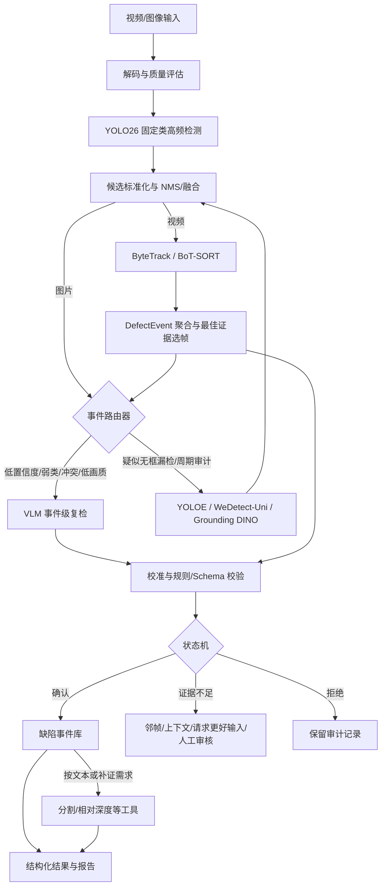

# VLM + YOLO 管网缺陷检测：架构、方法与调研总结

更新日期：2026-09-12
适用范围：CCTV 图片/离线视频 Agent 软件原型；以已有五类模型起步，检测器可替换，LLM/VLM 均通过 API 调用。基础类别为 `PL / BX / FS / BLOCK / AJ`；其他疑似缺陷先人工确认。

本文是需求与架构主文档。实施以第 9～10 节为准；第 2～8 节保留基线和研究背景，其中训练/蒸馏不在首版范围。开发任务只在[总体开发计划](../project_management/DEVELOPMENT_PLAN.md)维护。

2026-09-12 决策：依据管网对照与用户审查，YOLOE / OWLv2 / MM-Grounding-DINO 额外补检退出在线系统，保留代码和离线证据，不整体回退。下文研究背景中的开放候选建议不再代表实施要求。五类主检测、VLM 复检/融合及人工审核保留不变。

## 1. 直接结论

当前采用“可替换五类主检测 + 条件 VLM 语义复检与漏报审计 + 必要人工审核”的 Agent 系统，不以通用 VLM 替换已有检测器：

1. YOLO26 持续输出固定类别的框、类别和置信度；
2. ByteTrack 或 BoT-SORT 把逐帧框聚合成稳定 `track_id` 和 `DefectEvent`；
3. 事件路由器只把低置信度、弱类、跨帧冲突、低画质或模型分歧事件送给 VLM；
4. VLM 根据 ROI、上下文、多帧、专家定义、正例原型和难负例进行接受、改类、拒绝或请求更多证据；
5. 主检测器无框时仍做 VLM 全图/周期审计，不再调用额外开放检测器；
6. 新候选进入融合与证据复检；视频利用时序，单图利用原图上下文或人工确认；
7. 工作流与规则拥有业务状态迁移权，VLM 不能直接确认其他类别或生成几何真值。

需要特别区分：

- **在线 VLM 复检**可以改善最终事件级 precision、macro-F1、校准和人工审核效率，但不会自动改变 YOLO26 权重或单模型 mAP；
- **开放词表第二候选源**未在本次管网对照中得到足够收益，已退出在线调用；通用检测得分不能替代域内实测；
- **VLM/LLM 离线监督、伪标签或蒸馏**才可能得到一个部署时不依赖 VLM、但权重本身更强的新 YOLO；
- **LLM Agent 与报告生成**负责工具编排和事实表达，不等于检测精度提升。

## 2. 当前项目基线与问题定位

### 2.1 Sewer2403 五类完整模型

当前服务器交付包中的主模型是：

```text
YOLO26s + imgsz=960 + 100 epochs
PL / BX / FS / BLOCK / AJ
```

验证集共 1,904 张图片、1,407 个五类目标和 695 张负样本。总体结果为 Precision 0.636、Recall 0.592、mAP50 0.582、mAP50-95 0.389。

| 类别 | 含义 | Precision | Recall | mAP50 | mAP50-95 | 对 VLM/补召回的意义 |
|---|---|---:|---:|---:|---:|---|
| AJ | 支管暗接 | 0.895 | 0.852 | 0.917 | 0.721 | 高置信原型类；重点控制少量误报 |
| BLOCK | CJ/JG/ZW 合并的堵塞类 | 0.750 | 0.742 | 0.804 | 0.588 | 相对可靠，可作为正例原型；仍需区分真实堵塞与普通污渍 |
| PL | 破裂 | 0.644 | 0.585 | 0.585 | 0.333 | 形态跨度大；适合多帧、专家属性描述和难负例复检 |
| FS | 腐蚀 | 0.527 | 0.432 | 0.359 | 0.177 | 易与湿壁、污渍和照明混淆；优先 VLM 复检与纹理/材质建模 |
| BX | 变形 | 0.364 | 0.349 | 0.246 | 0.128 | 最弱且只有 43 个验证实例；优先补数据和几何信息，不能只靠语言判断 |

因此第一轮 VLM 实验应优先处理 `BX / FS / PL`，而不是平均地复检所有类别。`AJ / BLOCK` 可用于构造当前视频中的高置信正例原型。

### 2.2 Sewer2403 17 类历史参考（不作为当前模型路线）

17 类本地只保留日志和 `args.yaml`，没有 `best.pt`。日志中的高分类型包括：

| 类别 | 含义 | mAP50 | mAP50-95 | 判断 |
|---|---|---:|---:|---|
| Joint | 管道接口 | 0.994 | 0.865 | 外观规则，但不是病害类别 |
| TJ | 脱节 | 0.895 | 0.776 | 实际缺陷中较可靠 |
| CQ | 残墙、坝根 | 0.881 | 0.759 | 只有 16 个验证实例，统计不稳定 |
| AJ | 支管暗接 | 0.922 | 0.755 | 实际缺陷中较可靠 |
| CJ | 沉积 | 0.889 | 0.712 | 实际缺陷中较可靠 |

弱类主要是 `BX / FS / JG / QF`。这与五类模型中 BX、FS 仍然较弱相互印证：瓶颈更可能是样本量、视觉可分性、画质和几何表达，而不是类别数本身。

以上均为本地历史验证结果，不是独立测试集结论。详细证据见 `../yolov26/docs/sewer2403_5class_experiment_report.md`。

## 3. 推荐总体架构



### 3.1 快速环

快速环包括视频解码、YOLO26、候选标准化和跟踪。其目标是稳定吞吐和高候选召回，不能等待 VLM。

YOLO26 负责：

- 固定类别框、类别、分数；
- 每帧高频运行；
- 为跟踪器、事件聚合和第二阶段提供候选。

YOLO26 不负责：

- 跨帧身份稳定；
- 开放类别发现；
- 基于多帧证据的最终语义判断；
- 毫米级尺寸和维修决策。

### 3.2 跟踪与事件层

ByteTrack 先作为简单基线；移动镜头与重复纹理可能导致错配，先测试事件关联与边界去重，只有出现实测问题再评估必要的跟踪替代，不引入 SLAM。

跟踪层输出：

- `track_id`；
- 轨迹起止时间；
- 多帧类别与分数；
- 最清晰、最近、面积最大或最稳定的证据帧；
- 跨帧投票、短时漏检补偿和去重结果。

VLM 的默认调用单位是 `DefectEvent`，不是单帧。一个 2～5 秒事件通常只调用一次主复检，只有在 VLM 请求更多上下文、第二候选源产生新证据或用户提供更好输入后才再次复检。

### 3.3 事件路由器

推荐触发条件：

- YOLO 分数位于待复检区间；
- 类别属于 BX、FS、PL 等弱类；
- 同一轨迹的类别投票或框位置不稳定；
- 原图与增强图结果冲突；
- 图像模糊、过曝、污渍、水雾、遮挡或分辨率不足；
- YOLO26 与第二候选源分歧；
- 周期性无框漏检审计；
- VLM 返回 `need_more_context`；
- 高风险事件需要双模型确认。

路由器必须实现任务去重、优先级、超时、重试和背压。同一 `track_id` 的重复 VLM 请求应合并，只保留最新或质量最好的证据。

### 3.4 VLM 复检器

一次复检不应只提供紧裁剪 ROI。推荐输入包：

- 原始全帧；
- 带检测框全帧；
- 紧 ROI 和 1.5～2 倍上下文 ROI；
- 同一事件的前、中、后或最佳质量 1～3 帧；
- YOLO 类别、分数、框和轨迹稳定性；
- 媒体时间戳与画质；未提供的管材、管径、里程、标定等信息留空，不由模型猜测；
- 候选缺陷的专家定义、可观察属性、正例原型和难负例。

VLM 应输出受约束的 JSON，而不是自由文本覆盖检测结果：

```json
{
  "event_id": "pipe-001-event-00037",
  "track_id": 37,
  "decision": "accept|revise|reject|abstain|need_more_context",
  "canonical_label": "PL|BX|FS|BLOCK|AJ|OTHER|null",
  "open_label": null,
  "evidence": ["visible cue 1", "visible cue 2"],
  "confuser": "joint_shadow|null",
  "image_quality": "good|usable|poor",
  "needs_human_review": false
}
```

VLM 自报置信度不是校准概率。首版保留 `abstain` 并用固定案例检查可靠性，不在缺少数据时强行增加校准训练。

### 3.5 第二候选源

普通 ROI 复检只能判断已有框，无法恢复 YOLO26 完全没有产生候选的缺陷。第二候选源应扫描：

- 低质量或异常帧；
- 高分辨率整帧和切片；
- 轨迹中断区域；
- 周期覆盖窗口；
- VLM 请求更多上下文的区域；
- 低阈值 YOLO26 与质量异常检测器发现的可疑窗口。

当前候选优先级：

1. YOLOE：与 YOLO 系工程衔接最自然，支持文本、视觉和无提示模式；
2. WeDetect-Uni：通用候选与历史区域检索，适合研究型补召回；
3. YOLO-World：成熟开放词表基线；
4. Grounding DINO：较重，但适合离线高召回检索和标注；
5. Grounded SAM2：对候选做图像/视频掩膜与自动标注，不作为每帧主检测器。

第二候选不能直接变成确认缺陷。视频先关联轨迹，单图保留候选；由证据规则确认，OTHER 必须人工审核。

### 3.6 分割、量测和报告

检测框只能表示大致位置。首版只有单目 CCTV，分割与深度工具仅输出像素/相对结果。真实尺寸和堵塞率需要额外尺度与几何依据，不属于当前输入能力；VLM 不能猜毫米尺寸。

报告层只引用实际获得且经过校验的结构化事实；缺少里程、尺度或规范时明确缺失。LLM 可以组织文字，不能补写不存在的检测、尺寸或条款。

## 4. VLM + YOLO 方法分类

| 路线 | 是否改变 YOLO 权重 | 主要输入 | 主要输出 | 适合当前项目的作用 |
|---|---|---|---|---|
| 在线 ROI/事件复检 | 否 | YOLO 候选、多帧、上下文、专家定义 | accept/revise/reject/abstain | 降低误报、解决易混类、形成解释证据 |
| 视觉原型二次推理 | 通常否 | 第一遍高置信实例 token/embedding | 第二遍框和类别 | 用 AJ/BLOCK 等可靠实例辅助同视频复检 |
| 开放词表补候选 | 否 | 全帧/切片、文本或视觉提示 | 新候选框/掩膜 | 补完全漏检、未知异常、少样本类别 |
| VLM 伪标签教师 | 是，经过再训练 | 无标注视频、候选框、文本定义 | 经审核伪标签 | 扩充 BX/FS/PL 数据并训练新 YOLO |
| LLM/VLM 训练监督 | 是 | 区域短语、图像描述、grounding 数据 | 新检测器权重 | 把语言属性真正注入检测器训练 |
| VLM 合成异常 | 是，经过再训练 | 正常图、缺陷描述、生成/过滤模型 | 合成图和掩膜 | 少样本补充，但必须人工抽检和真实测试 |
| 测试时域适应 | 可能改变适配参数 | 新设备/新城市/新画质域 | 域适应后的预测 | 处理镜头、管材、污渍和光照域偏移 |
| Agent/报告生成 | 否 | 结构化检测、量测和规则 | 报告、查询、任务编排 | 提高工作流效率，不代表 mAP 增益 |

## 5. 代表论文与方法结论

下表将论文事实和本项目推论分开。论文在通用数据集上的 AP/F1 不能直接当作 Sewer2403 收益。

| 工作 | 正式状态 | 论文方法事实 | 对本项目的价值与边界 | 公开材料 |
|---|---|---|---|---|
| [PipeInspector / PipeInspect Agent](https://doi.org/10.1016/j.autcon.2026.106942) | *Automation in Construction*, 2026 | 图像增强、Grounding DINO、Grounded SAM、Depth Pro 与 LLM 工具编排串联 | 可借鉴增强、检测、分割、深度和报告工具链；Agent 本身不是检测增益证据 | 论文可查；未确认完整端到端训练仓库 |
| [Edge-Optimized VLM for Underground Infrastructure](https://arxiv.org/abs/2602.03742) | 2026 预印本 | 轻量 RAPID-SCAN 分割后，量化 Phi-3.5 Vision 生成缺陷摘要 | 证明“持续小模型 + 事件触发 VLM 摘要”的部署形态；不证明 VLM 回流提高分割精度 | 论文；代码状态需核查 |
| [Multi-class sewer defect detection with VLMs](https://doi.org/10.1017/wat.2026.10019) | *Cambridge Prisms: Water*, 2026 | 18 个 VLM 在 100 张 SewerML 图像上做六选一零样本分类；最佳 macro-F1 0.50，自报 confidence 不可靠 | 说明通用 VLM 尚不能替代专用检测器；必须允许拒识、校准并做领域适配 | [论文](https://www.cambridge.org/core/journals/cambridge-prisms-water/article/multiclass-sewer-defect-detection-with-visionlanguage-models/5A50F4D3610089FF1771B78D1FE69AB3)、[公开结果](https://huggingface.co/spaces/rtaormina/vlms_for_sewerml) |
| [PipeCLIP](https://doi.org/10.1109/TASE.2026.3670430) | IEEE T-ASE, 2026 | 使用缺陷条件文本与跨焦点视频表征改善管道缺陷视觉—语言对齐 | 专家属性描述、视频多焦点和缺陷语义先验值得用于 prompt/embedding；不能直接替代 bbox 检测 | DOI；匿名代码快照需核查长期可用性 |
| [YOLOE](https://openaccess.thecvf.com/content/ICCV2025/html/Wang_YOLOE_Real-Time_Seeing_Anything_ICCV_2025_paper.html) | ICCV 2025 | 将文本提示、视觉提示和无提示词表统一到实时检测/分割 | 当前最优先的第二候选源与视觉原型工具；需在 Sewer2403 实测候选互补性 | [官方代码](https://github.com/THU-MIG/yoloe) |
| [WeDetect](https://openaccess.thecvf.com/content/CVPR2026/html/Fu_WeDetect_Fast_Open-Vocabulary_Object_Detection_as_Retrieval_CVPR_2026_paper.html) | CVPR 2026 | WeDetect-Uni 产生通用候选和区域 embedding；WeDetect-Ref 用 LMM 单次分类候选 | 方法拆分与本架构高度一致：一支补候选，一支复检；仍需管网数据验证 | [官方代码](https://github.com/WeChatCV/WeDetect) |
| [ViTPrompt](https://openaccess.thecvf.com/content/CVPR2026/html/Qin_ViTPrompt_Training-Free_Prompt_Refinement_with_Visual_Tokens_for_Open-Vocabulary_Detection_CVPR_2026_paper.html) | CVPR 2026 | 第一遍高置信实例产生视觉 token，第二遍联合细化框和类别，免训练 | 可把 AJ/BLOCK 高置信实例变成同视频视觉原型；两遍推理更适合事件慢环 | 论文；公开代码状态需再次核查 |
| [ROD-MLLM](https://openaccess.thecvf.com/content/CVPR2025/html/Yin_ROD-MLLM_Towards_More_Reliable_Object_Detection_in_Multimodal_Large_Language_CVPR_2025_paper.html) | CVPR 2025 | 强化 MLLM 在零目标、多目标、grounding 与 `None` 情形下的可靠检测输出 | 适合借鉴“没有缺陷”和多候选输出设计；不建议直接用自由文本框替换 YOLO | 论文页 |
| [LLMDet](https://openaccess.thecvf.com/content/CVPR2025/html/Fu_LLMDet_Learning_Strong_Open-Vocabulary_Object_Detectors_under_the_Supervision_of_CVPR_2025_paper.html) | CVPR 2025 Highlight | 用区域短语、图像级详细描述、grounding loss 和 caption loss 共同训练开放词表检测器 | 最接近“用 LLM/VLM 真正提升检测器权重”的顶会依据；迁移成本高于在线复检 | [代码、模型与数据](https://github.com/iSEE-Laboratory/LLMDet) |
| [VL-PLM](https://arxiv.org/abs/2207.08954) | ECCV 2022 | 类别无关 proposal + CLIP 相似度生成伪框，再训练检测器 | 可用于未标注管道视频候选挖掘；必须记录伪标签 precision 和人工审核量 | [官方代码](https://github.com/xiaofeng94/VL-PLM) |
| [VLM-PL](https://arxiv.org/abs/2403.05346) | CVPR 2024 Workshop | VLM 验证类增量检测中的旧类伪标签 | 适合把复检设计为明确的是/否问题；不是当前固定五类的首要方法 | 论文页 |
| [MIRAGE](https://arxiv.org/abs/2603.13507) | CVPR 2026 VAND Workshop/预印本 | VLM 生成异常描述，图像生成器合成缺陷，CLIP 过滤，并生成掩膜 | 可针对 BX/FS/PL 少样本做探索；必须与传统增强、重采样和真实数据扩充比较 | [代码](https://github.com/vadnomalous/mirage) |
| [YOLO-World](https://openaccess.thecvf.com/content/CVPR2024/html/Cheng_YOLO-World_Real-Time_Open-Vocabulary_Object_Detection_CVPR_2024_paper.html) | CVPR 2024 | CLIP 文本编码与 YOLO 区域对齐的实时开放词表检测 | 作为 YOLOE 的成熟对照，不建议两者同时成为生产主检测器 | [官方代码](https://github.com/AILab-CVC/YOLO-World) |
| [Grounding DINO](https://arxiv.org/abs/2303.05499) + [Grounded SAM2](https://github.com/IDEA-Research/Grounded-SAM-2) | 论文 + 官方工程链 | 自由文本 grounding 与图像/视频分割组合 | 适合疑难帧、离线高召回标注和精细掩膜；不适合替代 YOLO26 高频主环 | [Grounding DINO 代码](https://github.com/IDEA-Research/GroundingDINO) |

## 6. 推荐 Prompt 与专家知识组织

类别名本身信息不足。应把每个类别改写成可观察证据：

```text
类别定义
  + 典型形态、纹理和空间位置
  + 与管道接口、湿壁、阴影、污渍的区别
  + 正例图像原型
  + 难负例图像原型
  + 允许拒识的条件
```

推荐 VLM 先回答可观察问题，再输出类别。例如 PL：

1. 是否存在连续或分叉线状开口？
2. 边缘是否不规则，且不同于规则接口环？
3. 多帧中位置是否固定在同一管壁区域？
4. 是否可能只是反光、水迹、污渍或压缩伪影？
5. 当前证据是否足够确认，还是应返回 `abstain/need_more_context`？

Prompt 实验必须固定相同 VLM 版本、解码参数、ROI、上下文、帧数和测试集，分别比较：仅类别名、专家定义、正例原型、难负例、多帧和元数据的增量贡献。

## 7. 训练与数据闭环（未来研究，首版不实施）

```text
生产/历史视频
  -> 低阈值 YOLO26 + YOLOE/Grounding DINO 候选并集
  -> 跟踪聚合与去重
  -> VLM 语义过滤和属性描述
  -> 人工确认/修改
  -> 高价值样本库
  -> 重采样、传统增强、VLM 合成或语言监督
  -> 新 YOLO26 训练
  -> 固定 test 上评估 YOLO-alone
```

必须区分收益来源：

- 更多真实数据；
- 传统增强或类别重采样；
- VLM 过滤后的伪标签；
- VLM 生成描述/合成图；
- 推理时仍调用 VLM。

如果最终希望边缘端只运行 YOLO，应在推理时关闭 VLM，单独报告新 YOLO 的 mAP、per-class AP 和鲁棒性，证明知识已经蒸馏回权重。

## 8. 研究实验矩阵（非开发排期）

| 编号 | 组合 | 目的 | 主要指标 |
|---|---|---|---|
| E0 | YOLO26 单帧 | 固定检测基线 | mAP50-95、per-class AP、FPS |
| E1 | E0 + tracker + DefectEvent | 去重和跨帧稳定 | event precision/recall、ID switch、重复事件率 |
| E2 | E1 + VLM 类别名复检 | 最朴素 VLM 是否有效 | event macro-F1、误报下降、触发率 |
| E3 | E2 + 专家属性文本 | PipeCLIP/SRA-Det 思路 | BX/FS/PL F1、混淆矩阵 |
| E4 | E3 + 正例/难负例视觉原型 | ViTPrompt/视觉提示思路 | 易混类 precision/recall |
| E5 | E4 + 同轨迹三帧 | 验证多帧证据 | event F1、结论一致性、延迟 |
| E6 | E5 + abstain/校准 | 控制幻觉和过度确认 | ECE、拒识率、人工审核率 |
| E7 | E6 + YOLOE | 补完全漏检 | candidate recall、rare-class recall、最终 precision |
| E8 | E7 + Grounding DINO 离线审计 | 估计开放候选上限 | 候选并集召回、每小时成本 |
| E9 | 人工确认伪标签再训练 YOLO26 | 让权重本身提升 | YOLO-alone test mAP、BX/FS/PL AP |

所有实验必须使用相同 split、相同视频分组规则和相同事件匹配协议。不能把图像分类 macro-F1 与检测 mAP 直接横向比较。

## 9. 首版范围与开发顺序

本节起为 2026-09-09 用户对齐后的实施约定；前述论文、训练方法与实验矩阵属于研究背景，不自动进入开发范围。

首版是完整 Agent 软件原型：CCTV 图片/离线视频 + 文本任务；已有五类检测器 + 视频事件 + 条件 VLM 复检 + 可恢复工作流 + 人工审核 + 结构化报告，并支持按需增强、分割和相对深度等后置工具。不是训练或优化某一个 YOLO26 模型。

LLM 和 VLM 均调用外部 API。本 GPU 服务器运行后端和本地视觉工具；没有管径、相机标定、里程或额外传感器输入，不规划机器人控制或真实几何量测。

唯一开发路线见[总体开发计划](../project_management/DEVELOPMENT_PLAN.md)：M0 技术验证 → M1 图片/文本/报告 → M2 视频/恢复/审核 → M3 开放候选与效果对照 → M4 后置工具 → M5 整体验收。具体任务和实际进度只在计划及 Trellis 中维护；用户已批准并开始开发。

## 10. 运行协议

### 10.1 模块与职责

采用 FastAPI + Temporal + PostgreSQL + 本地持久资产目录，模块化后端配 CPU/API worker 与单 GPU worker；不按每个模型拆十个微服务。Temporal 是唯一持久工作流执行器，首版不叠加 LangGraph、额外队列或多 Agent 自由协商。

LLM 将文本转换成结构化 TaskPlan，提议合法工具顺序并组织报告；VLM 只提出视觉判断。普通代码校验 Schema、前置条件、预算、状态迁移和最终事实。模型调用与其他 I/O 位于 Activities，不进入需要确定性重放的 Workflow。

TaskPlan 包含目标五类、动作、输出和预算。动作限定 detect、verify、segment、relative_measure、compare、retrieve_standard、summarize、export_report 等白名单；基础检测不可因文本过滤而绕过。历史 open_scan / 开放审计字段保留用于读旧数据，新任务拒绝启用。不执行任意 shell、路径或模型返回的指令。

首版交互入口为对话＋CCTV 文件上传，支持围绕既有结果追问、引用证据并追加合法工具操作。会话关联任务与资产；只解释已有结果时不重新检测，追加分析以关联操作/运行保留原结果，不悄悄覆盖已完成证据。长任务不依附浏览器连接。T04 先落地会话关联的文件/文本提交与查询；T06 实现受约束对话和工具决策，所有实际执行仍由 Temporal 承担。

### 10.2 图片与视频两条管线

图片：输入/质量校验 + 文本解析 → 原图主检测 → 条件 VLM 复检与全图审计 → 规则融合 → 必要人工审核 → 按文本调用后置工具 → 校验结果与报告。单图不虚构轨迹或时序证据。

视频：输入/文本解析 → 分块解码与质量分析 → 主检测 → 跟踪和事件聚合 → 最佳多帧证据 → 条件 VLM 复检及负结果审计 → 审核与后置工具 → 事件时间轴和报告。

首版默认主检测覆盖所有可解码视频帧，分块与批处理控制资源。可选降采样必须显式记录处理范围、采样策略、解码缺口与盲区；候选窗口加密不能证明采样间隙没有缺陷。时间以媒体原始时间戳为准，不用固定 FPS 猜测可变帧率视频时间。

块边界保留重叠证据或跟踪状态并确定性去重。事件表示一次连续可见的缺陷片段，不保证跨回访/镜头跳转仍是同一物理缺陷。只向 VLM 提交少量有代表性的证据，不逐帧调用。

### 10.3 主检测器、VLM 与结果判定

| 能力 | 作用 | 调用条件 |
|---|---|---|
| 可替换主检测器，首个为已有 YOLO26 | 五类定位与初查 | 所有图片和纳入覆盖范围的视频帧 |
| VLM API | 候选复检、全图负结果审计、请求补证 | 弱类/中低置信、冲突、画质问题、负结果审计或文本要求 |

只有 ROI 复检不能覆盖主检测器完全漏报，因此零结果仍需 VLM 全图/视频周期审计。VLM 可提出其他异常并交人工确认，不以额外开放检测器作为前置或后置步骤。遗留模型配置不能重新启用已停用分支。

VLM 输出 accept / revise / reject / abstain / need_more_context；这是建议，不是直接的业务状态迁移。规则综合原图、检测器、时序和审计证据：冲突时不能仅凭 VLM 自报信心删除强证据；补证仍冲突则转人工。其他候选必须经人工确认；VLM 可提供 open_label，不能自行确认为新缺陷类别。

### 10.4 类别、审核与工作流状态分离

| 字段 | 取值 / 含义 |
|---|---|
| Finding.canonical_label | PL / BX / FS / BLOCK / AJ / OTHER；定位前的未分类候选可为空 |
| Finding.open_label | 其他类别建议名称，可空；不是新枚举 |
| Finding.review_status | tentative / confirmed / rejected / needs_review |
| Task.inspection_result | pending / normal / defects_found / inconclusive |
| Task.runtime_status | queued / running / waiting_review / completed / partial / failed / cancelled |
| Task.stage | 解码、检测、事件聚合、复检、工具执行、审核、报告等当前阶段 |

NORMAL 不是目标检测类别；UNCERTAIN 不是第七种缺陷。未映射的开放词表对象不自动等于缺陷，先判断是否为异常，再决定是否建立 OTHER 待审候选。

“正常”要求当前检查范围有足够画质与覆盖、完成规定的负结果审计、没有确认缺陷或未解决候选。原始候选可因充分证据被驳回后得到正常；必需复检失败、质量不可判、覆盖不足不能当正常。局部已确认缺陷与其他片段证据不足可以同时存在，报告必须同时展示发现与限制。

Sewer2403 五类负样本可能来自其他原始类别，不能直接作为真正常标签；见[五类实验报告](../yolov26/docs/sewer2403_5class_experiment_report.md)。正常判定需要人工确认的负例回归集。

### 10.5 持久化、可靠调用与进度

每个媒体任务对应持久 InspectionWorkflow。进度输出 task_id、stage、stage_progress、overall_progress（估算）、已处理帧/块、active_tool、retry_count、waiting_reason、updated_at；不能把检测进度 100% 误当整个任务完成。

每块保存 input_asset_id/version、时间/帧范围、运行配置版本和输出资产清单。已完成块提交检查点；重启后从未完成块继续，必要时恢复重叠边界。任务开始固定模型、Prompt 和配置版本；新版本通过显式新运行重处理，不能在恢复时静默混用。

所有工具声明输入/输出 Schema、前置条件、资源、超时、重试、幂等和副作用。调用记录 call_id、业务幂等键、attempt、输入资产 ID、工具/模型版本和结果/错误。暂定单事件最多一次自动补证、两次语义复检；不预留开放扫描预算，网络重试另设上限并计入成本。

本地活动可能至少执行一次，用数据库唯一键、结果复用及原子提交避免重复结果；不声称外部 API 恰好执行一次。超时可能已经产生费用，需记录不确定状态并限制重试；参数错误、缺输入、不可恢复 OOM 不盲目重复。长活动发送 heartbeat，GPU 活动控制资源和取消。

顺序由显式依赖管理，例如有效候选 → 分割 → 像素/相对量；校验后的事实 → 报告。增强可在低质量复检前，分割也可为待审候选提供补证，不要求所有路径强制经过所有模型。

人工审核通过持久信号/更新恢复，等待是非终态且不占 GPU；审核请求带版本和幂等键，防止重复或过期结果覆盖。用户必需动作全部完成才 completed，必要步骤未完成则 partial/failed 并解释。取消保留已完成证据；续跑取消任务需显式关联新运行。

Temporal 历史、业务库和资产目录必须持久化；工作流完成以外部写入已确认、所有必需动作已校验为准。故障恢复只承诺测试过的进程/网络故障，不把同机持久化说成磁盘损坏后的灾备。

### 10.6 增强、分割与深度

首版复用预训练模型，不自行训练。当前图片增强为 DarkIR-m（低照度）、DehazeFormer-MCT（去雾）、Restormer（去模糊）、Real-ESRGAN（超分）；HVI-CIDNet 已有离线对照。它们是当前可用模型，不是已经证实的管网最优组合，后续以缺陷保真与检测收益选择替代。分割/深度已完成 SAM 2.1 Hiera Large、Depth Anything V2 Small 的本地工具与六图验证，并接通显式对话、持久工作流和页面（T13-B），按需串行加载；仅输出待复核的像素/相对量，不改检测结论，见 [T13-B 记录](../.trellis/tasks/09-13-m4-geometry-online/report.md)。

质量门控先看清晰度、对比度、亮度/过曝、有效目标像素、反光/污渍与视频变化，再决定是否试用一种针对性增强。没有通用“模糊分 > 某值必调模型”的可靠常数；质量评分不是缺陷概率。

| 输入情形 | 动作 |
|---|---|
| 质量足够 | 只用原图 |
| 可恢复模糊 / 疑似雾化 | 在有代表性的帧/ROI 上试用对应增强，并与原图比较 |
| 原图清晰但目标像素不足 | ROI 超分作为辅助观察 |
| 严重过曝、完全失焦或遮挡 | 标记不可判，请求更好输入或人工；不生成假细节 |
| 原图与增强图冲突 | 保留两份证据，进入复检；不自动选择分数更高者 |

增强产生派生资产，绝不覆盖原图；候选数/置信度升高不证明正确。自动触发默认策略要由真实退化集效果支持，无收益则关闭该自动触发但保留显式工具能力。

2026-09-13 对齐并实现 T12-C：增强不是必经流程。默认关闭自动执行；本次对话允许按需增强后，原图检测/原 VLM → 独立 VLM 选择与理由 → 后端校验固定模型、原图 ROI 和预算 → 最多一次增强/双图复核，或保存跳过原因。质量阈值、检测低置信度不能单独触发；选择结果持久化恢复，选择失败不抹除原成功复核。2026-09-14 补齐已有关联原图的本轮授权按需增强：复用冻结检测/复检，共享原任务一次补证额度；跳过保留基线，失败明确不完整。视频证据帧入口待接入；不替换已验收原 VLM 策略。小样本输出见 [T12-C 记录](../.trellis/tasks/09-13-m4-adaptive-enhancement/report.md)，关联闭环见[补齐记录](../.trellis/tasks/09-14-m4-linked-adaptive-enhancement/report.md)。

分割按精确区域请求、可视化或补证需求调用；SAM 2 可以检测框提示。深度只用于相对形状分析；无尺度时只报像素面积、相对深度及明确的投影比例，不能称作真实长度/体积堵塞率。生成式超分不作为量测真值。

### 10.7 报告与后置任务

基本 JSON/HTML 报告从图片闭环开始交付，后续增加视频证据和可选分析。报告由已校验事实生成；未审核建议与确认结论分开，所有跳过/失败动作说明原因。

历史比较需要第二份或已存媒体，并保留匹配不确定性；规范检索需要真实版本化文档和条款定位，没有规范或所需测量不能评级。缺少外部输入时返回明确不可完成原因，不让 LLM 编造尺寸、里程、条款或维修结论。

T14-A 将比较限定为同会话两个不同、已结束且媒体类型一致的检查，冻结源结果与逐类审核状态计数，生成独立对话报告；不重跑模型、不改源结论。不做物理位置配准，记录差异不代表真实新增/消失或维修效果。规范检索 T14-B 待明确采用的文档与版本。

### 10.8 检测器解耦与开发边界

DetectorAdapter 至少提供模型元信息、能力声明、加载/预热和图片/批量推理；输出标准 bbox 坐标、原生标签/分数、五类映射及版本。跟踪、复检、Agent 只依赖标准契约，不读取 YOLO 专有对象。类别映射、阈值和资源配置随模型版本管理。

首个真实适配器接已有 YOLO26，用测试替身验证替换契约；停用额外开放补检不影响主检测器可替换性。历史开放适配器仅保留离线使用。将来替换真实模型仍需兼容与效果评估，不预建未需要的插件平台或多模型常驻集群。

日常追溯使用资产 ID、版本和调用记录，不强制生成输入/模型/Prompt 哈希。开发 harness 使用 Trellis + jj + 相关测试和简短交接；与产品的 Temporal 恢复机制分开。训练、蒸馏、SLAM、传感器标定和分布式平台不在本次开发范围。

## 11. 深入阅读（研究参考）

- [管网论文与 Prompt](research/summary_yolo_vlm_pipe_inspection.md)
- [VLM 参与检测、伪标签与域适应](research/summary_vlm_enhanced_yolo_detection_survey.md)
- [脏数据与预处理](research/summary_pipe_dirty_data_preprocessing.md)
- [旧完整架构](research/architecture_yolo26_vlm_pipe_inspection.md)：含旧 SEDD 三类/扩展研究假设，不能覆盖本主方案。
